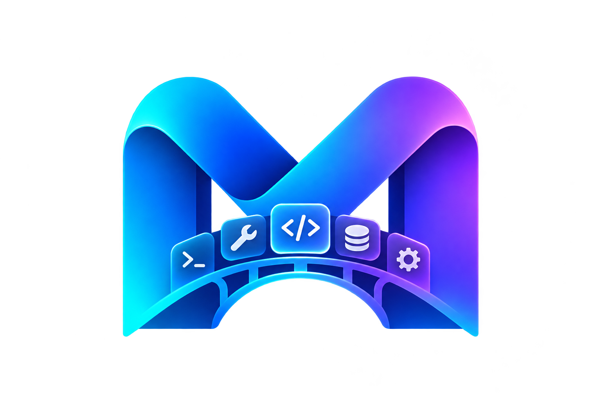

<div align="center">
  
</div>

# Driving the MCP servers from an AI agent

This file is for an AI (or a human wiring an AI up). It explains how to start this project's bridge and
call its MCP tools directly, with no model and no `llama-server` in the loop.

Everything goes through one script: **`scripts/mcp.mjs`**. It has no dependencies, needs only Node 18+, and
prints exactly one JSON document on stdout per command (progress notes go to stderr).

---

## 0. Start it from the menu first

If the bridge has just been installed, bring it up through the menu before running anything else:

```bash
node scripts/menu.mjs      # 1) Start   2) Stop   3) Refresh   0) Quit
```

It prints whether the bridge is running (panel URL, connected servers, tool count) and then runs the same
`up` / `down` as the CLI, so whatever it starts is exactly what the commands below see. Press **1** to start
and **2** to stop; `node scripts/menu.mjs start|stop|status` does the same without the prompt, and
`--port <n>` overrides the default `7800`.

The menu is the human entry point. An agent should keep using the non-interactive commands in section 1.

---

## 1. Start it

```bash
node scripts/mcp.mjs up
```

That is idempotent: if the bridge is already listening it reuses it; otherwise it starts
`src/server/index.ts` detached, waits for readiness (30 s cap), writes `data/bridge.pid`, logs to
`data/bridge.log`, and then connects every **enabled** MCP server that is not already connected
(pass `--no-connect` to skip that).

Output includes everything needed to continue:

```json
{
  "ok": true,
  "started": true,
  "pid": 24188,
  "panel": "http://127.0.0.1:7800/",
  "openaiBaseUrl": "http://127.0.0.1:7800/v1",
  "upstream": { "reachable": false, "error": "not reachable at http://127.0.0.1:8080" },
  "connected": [{ "id": "filesystem", "status": "connected", "tools": 16 }],
  "servers": [{ "id": "filesystem", "status": "connected", "tools": 16 }],
  "tools": 16
}
```

`upstream.reachable: false` is normal and harmless: it only means `llama-server` is not running. Direct
tool calls do not need it.

## 2. Find out what you can call

```bash
node scripts/mcp.mjs tools
```

```json
[{ "exposedName": "filesystem__list_directory", "server": "Filesystem",
   "permission": "allow", "enabled": true, "description": "List the contents of a directory…" }]
```

Tool names are namespaced `serverId__toolName`. Then get the argument schema:

```bash
node scripts/mcp.mjs describe filesystem__read_file
```

```json
{ "exposedName": "filesystem__read_file",
  "inputSchema": { "type": "object",
                   "properties": { "path": { "type": "string" }, "head": { "type": "integer" } },
                   "required": ["path"] } }
```

## 3. Call a tool

```bash
node scripts/mcp.mjs servers                                # what is configured?
node scripts/mcp.mjs add <id> --command uvx --args pkg      # create a server, then connect it
node scripts/mcp.mjs test <serverId>                        # connect, report status/tools, restore state
node scripts/mcp.mjs doctor [serverId]                      # resolved executable, status, tools, recent logs
node scripts/mcp.mjs remove <serverId>                      # delete a server and its stored secrets
node scripts/mcp.mjs call <serverId>__<toolName>
node scripts/mcp.mjs call <serverId>__<toolName> '{"arg":1}'
echo '{"arg":1}' | node scripts/mcp.mjs call <serverId>__<toolName> -
```

`add` takes the launch details: `--command <exe>` with `--args <a> [b ...]` for a local stdio server, or
`--url <url>` with repeatable `--header KEY=VALUE` for a remote Streamable HTTP one. `--env KEY=VALUE` is
repeatable and plain config, so keep tokens in the panel; `--name`, `--description` and `--no-connect` are
optional. `doctor` prints the executable actually launched (after PATH resolution), the status, the tools
and the last log lines (`--lines <n>`, default 20), and works with the bridge stopped; it exits `1` when a
server is broken.

`--args` stops at the next `--flag`; a bare `--` ends option parsing and everything after it is a server
argument, so a flag such as `--port 8080` can be passed: `--args app.mjs -- --port 8080`.

There is no vendor-specific tool name in this file on purpose: the bridge works with whatever servers you
configure, and every tool is addressed as `serverId__toolName`.

Result envelope — always the same shape:

```json
{ "ok": true, "tool": "<toolName>", "server": "<serverId>",
  "durationMs": 1, "isError": false, "result": { } }
```

Exit code is `0` when the tool succeeded, `1` when it returned an error or the call failed, `2` on bad
usage. Read `isError` and `result`; `result.output` holds captured stdout for the `run_script` style tools.

### Code tools, without guessing their argument names

Code-execution tools differ per server (`run_script`, `execute`, `run_python`, …) and name their payload
differently (`script`, `code`, `source`). The CLI looks at the tool's schema and uses the right name:

```bash
node scripts/mcp.mjs script ./probe.py                      # the only code tool on the bridge
node scripts/mcp.mjs script ./probe.py --server <serverId>  # limit auto-detection to one server
node scripts/mcp.mjs script ./probe.py --tool <exposedName> # exact tool
node scripts/mcp.mjs script - < probe.py                    # stdin
```

If more than one tool matches it fails with `candidates` rather than picking one, so you never send code
to the wrong server by accident.

### Recipes: one command for a multi-step job

A recipe lives in `recipes/<name>/`: `recipe.json` names the server and tool, `kit.py` does the work and
**verifies** it, so a single call replaces a probe loop:

```bash
node scripts/mcp.mjs recipe <name> <spec.json>
```

A recipe is a `recipe.json` that either lists **steps** (plain tool calls — works with any server) or names a
code tool plus a kit. `recipes/filesystem-inventory` is the step example; the format is in
`recipes/README.md`. Failures make the command exit `1`, and a missing spec value fails with the key name
instead of sending a placeholder to the server.

## Use it from another MCP client

The bridge is also an MCP server at `http://127.0.0.1:7800/mcp` (Streamable HTTP, POST only). Registering
that URL in any MCP client hands it this machine's whole catalog, named `serverId__toolName`, with the panel's
Allow / Ask / Deny policy applied:

```jsonc
{ "mcpServers": { "bridge": { "type": "http", "url": "http://127.0.0.1:7800/mcp" } } }
```

An `ask` call blocks until the approval is answered in the panel (60 s, then denied), a `deny` call comes
back as an error result, and a stopped server reconnects on the next call. `GET /mcp` answers **405** because
this endpoint does not open a server-initiated SSE stream.

## 4. Stop it

```bash
node scripts/mcp.mjs down
```

Only stops a bridge started by this script (it reads `data/bridge.pid`). If the bridge was started some
other way it refuses and tells you so, rather than killing a process it does not own.

---

## Ready-to-paste agent instructions

> You have access to a shell and a local MCP bridge.
>
> - Start or verify it: `node scripts/mcp.mjs up`. It prints JSON; check `ok` and `servers[].status`.
>   `upstream.reachable: false` is fine — that is only the local LLM and direct tool calls do not need it.
> - Discover tools: `node scripts/mcp.mjs tools` (then `describe <exposedName>` for the schema).
>   Never guess a tool name or its arguments; read them first.
> - Call a tool: `node scripts/mcp.mjs call <exposedName> '<json arguments>'`. Every result is JSON with
>   `ok`, `isError`, `durationMs`, `result`. Exit code 1 means the call failed: read `error` on stdout.
> - Tool names are `serverId__toolName`. Tools with permission `ask` or `deny` reject direct calls with
>   HTTP 403 — say so instead of retrying.
> - To send code to a code-execution tool, write a `.py`/`.js` file and use
>   `node scripts/mcp.mjs script ./file.py [--server <id> | --tool <exposedName>]`, rather than escaping
>   code into a JSON string.
> - For a repeatable multi-step job use `node scripts/mcp.mjs recipe <name> <spec.json>` when a recipe
>   exists for that server. A recipe verifies its own work and exits `1` when it could not.
> - Servers stop themselves after 5 minutes idle (`IDLE STOP (S)` = 300). A direct `call` reconnects the
>   owning server by itself and returns `"reconnected": true`, so do not re-run `up` after every call. Only
>   discovery (`tools`, `describe`, `script`, `recipe`) needs `up` when it reports an idle-stopped server.
> - Large bulk operations can exceed the 60 s MCP tool timeout while still succeeding in the background.
>   After a timeout, re-read state instead of retrying blindly, or you will duplicate work.

---

## Notes and gotchas learned from real use

**Per-tool behaviour**

- A tool's argument names come from its schema — do not assume `script`/`code`; `describe` shows them.
- Some tools return `False` or `None` where an exception would be expected. Treat a success return as a
  claim and verify the changed state when the operation matters.

**Bridge behaviour**

- Per-tool permissions: `allow` → direct call works; `ask`/`deny` → HTTP 403 with a clear message.
- `data/servers.json` holds config, `data/secrets.json` holds secrets and is never returned by the API.
- The panel at `/` has a Chat tab (needs `llama-server`) and a **Direct tool** tab (works without it) — the
  same capability as this CLI, in a browser.

## Troubleshooting

| Symptom | Meaning | Fix |
| --- | --- | --- |
| `Bridge is not reachable at …` | not started | start it from the menu (`node scripts/menu.mjs`) or `node scripts/mcp.mjs up` |
| `MCP_TOOL_NOT_FOUND: Unknown tool` | server idle-stopped | `call` reconnects on its own (`"reconnected": true`); `tools`/`describe`/`script`/`recipe` still need `node scripts/mcp.mjs up` |
| HTTP 403 on `call` | tool is `ask`/`deny` | change the permission in the panel's Servers tab |
| `Unknown tool: x` from the CLI | name not in the catalog | `node scripts/mcp.mjs tools` for exposed names |
| `Several code-execution tools match` | auto-detection refused to guess | pass `--tool` or `--server` |
| `No servers yet` | nothing configured | add one in the panel or copy from `servers.example.json` |
| `UPSTREAM_UNREACHABLE` | only affects model chat | start `llama-server` if you want the model |
| `MCP_CONNECTION_TIMEOUT` | tool ran past 60 s | re-read state; do not blindly retry |

For the model-driven path (tool injection into `llama-server`), see `README.md`. For the CLI's own flags run
`node scripts/mcp.mjs --help`.
